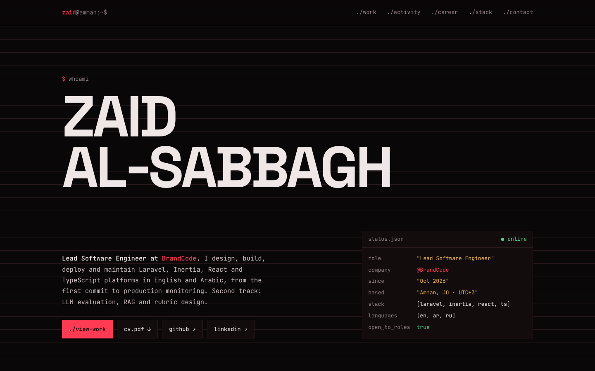
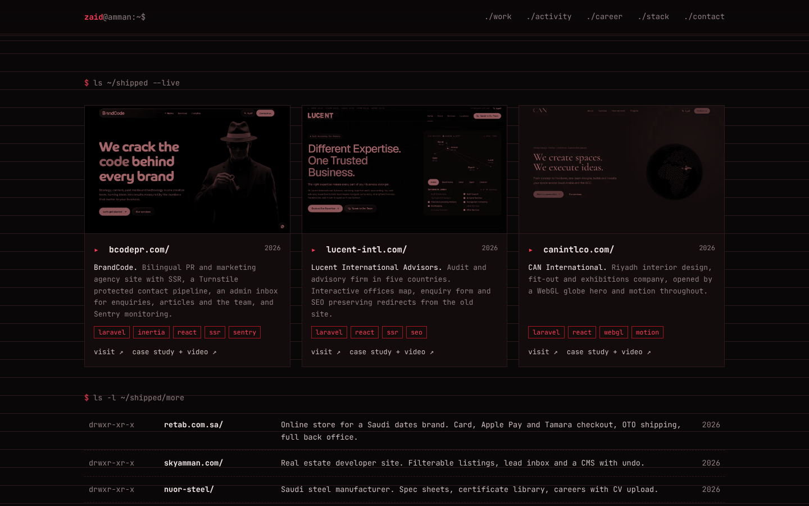

```console
zaid@amman:~$ cat README.md
```

# Zaid Al-Sabbagh · portfolio

The source of my personal site: **[professional-portfolio-v2-dis2.vercel.app](https://professional-portfolio-v2-dis2.vercel.app)**

I'm a Lead Software Engineer at [BrandCode](https://bcodepr.com), building Laravel, Inertia, React and TypeScript platforms in English and Arabic. The site is a single page in the same **Crimson Terminal** style as my [GitHub profile](https://github.com/mercenary19961): every section opens with a shell command.

| command | what it shows |
|:--|:--|
| `whoami` | who I am, plus a `status.json` with my current role |
| `ls ~/shipped --live` | BrandCode, Lucent and CAN International, with screenshots that turn from red to full colour on hover, then a list of earlier builds |
| `git log --since="1 year ago" --graph` | my contribution graph, private work included |
| `git log --career --oneline` | experience as commits; open one to read the details |
| `cat stack.json` | the tools I use, and what I'm learning now |
| `echo $CONTACT` | email with a copy button, LinkedIn, GitHub and the CV |



## Built with

`Next.js 16` (App Router, fully static) · `React 19` · `TypeScript` · `Tailwind CSS 4` for the reset, hand-written CSS for the rest · `next/font` with Space Grotesk and JetBrains Mono · deployed on `Vercel`.

No UI kit and no animation library. Motion is CSS only and switches off under `prefers-reduced-motion`.

## How it fits together

```text
src/
├─ data/profile.ts        all the words: role, projects, career, stack, links
├─ app/
│  ├─ layout.tsx          fonts, metadata, Open Graph
│  ├─ page.tsx            the section order
│  └─ globals.css         Crimson Terminal tokens and every style
└─ components/            one file per section (Hero, Shipped, Activity, Career, Stack, Contact)
public/
├─ shots/                 project screenshots (webp)
└─ cv.pdf                 the CV behind every "cv.pdf ↓" button
```

**Updating content** means editing `src/data/profile.ts` and nothing else. Swap `public/cv.pdf` when the CV changes.

**The contribution graph** is not built here. A nightly GitHub Action in [mercenary19961/mercenary19961](https://github.com/mercenary19961/mercenary19961) redraws `assets/contributions.svg` from the GraphQL API, and this site loads that file. It stays current with no token, no API call and no redeploy.

**Client code is private.** Case studies and walkthrough videos live in [brandcode-showcase](https://github.com/mercenary19961/brandcode-showcase) and [showcase](https://github.com/mercenary19961/showcase).

## Run it

```bash
npm install
npm run dev      # http://localhost:3000
npm run build    # static production build
npm run lint
```

## Contact

[sabbaghzaid88@gmail.com](mailto:sabbaghzaid88@gmail.com) · [LinkedIn](https://www.linkedin.com/in/zaid-sabbagh-6a7287227/) · [GitHub](https://github.com/mercenary19961)
